# StockCount Windows 5080 端口开放与局域网排查

适用 Windows 10/11、Windows Server 及 StockCount Avalonia 后台。以下以默认业务端口 TCP 5080 为例；如修改业务端口，命令与 PDA 地址同步修改。本文未修改实际服务器防火墙，请由现场管理员执行。

## 1. 端口用途

| 端口 | 用途 | 是否开放入站 |
|---|---|---|
| TCP 5080 | PDA 业务 API、健康检查、Swagger | 仅可信 PDA 网段 |
| TCP 5081 | 本机管理与内部健康检查（业务端口 + 1） | 否，仅回环 |
| TCP 1433（示例） | 服务器到 Sage X3 SQL Server | 不需要为 PDA 在 API 主机开放 |

依据 [API Program.cs](../src/StockCount.Api/Program.cs) 与 [Avalonia 界面](../src/StockCount.Server.Desktop/MainWindow.axaml)：启用可信局域网 HTTP 后，Kestrel 业务端口监听所有 IP；关闭时只监听 localhost。管理端口始终 localhost。不要做公网端口映射、不要关闭整个 Windows 防火墙。免密访问仅用于隔离可信 PDA 网络。

## 2. 启动 API 与确认网卡

双击 StockCount.Server.Desktop.exe，进入 API / PDA，确认监听端口 5080，勾选“允许可信隔离局域网 HTTP (监听所有 IP)”，按现场认证政策配置设备密钥或隔离网免密，保存后启动或重启 API。暂停 PDA 提交再重启。

在 PowerShell 检查 IP、网络类别：

```powershell
ipconfig
Get-NetIPConfiguration
Get-NetConnectionProfile | Format-Table InterfaceAlias,NetworkCategory,IPv4Connectivity
```

选择与 PDA 互通的实际网卡 IPv4。以下以 192.168.1.100 为服务器示例，PDA 子网 192.168.1.0/24 为示例，不能直接套用到所有现场。域网络或可信专用网络才使用下列默认规则；若网卡为 Public，请先由管理员确认网络性质与组织策略，不要盲目切换网络类别。

## 3. 创建防火墙规则（管理员 PowerShell）

推荐限定真实 PDA 网段（替换示例 CIDR）：

```powershell
New-NetFirewallRule -Name "StockCount-API-TCP-5080" -DisplayName "StockCount API TCP 5080" -Direction Inbound -Protocol TCP -LocalPort 5080 -Action Allow -Profile Domain,Private -RemoteAddress 192.168.1.0/24
```

如果尚不知道具体 CIDR 且整个本地子网均为可信设备，可改用 LocalSubnet：

```powershell
New-NetFirewallRule -Name "StockCount-API-TCP-5080" -DisplayName "StockCount API TCP 5080" -Direction Inbound -Protocol TCP -LocalPort 5080 -Action Allow -Profile Domain,Private -RemoteAddress LocalSubnet
```

二选一，不要重复创建。跨 VLAN 的 PDA 需按实际源网段配置并核查路由和 ACL。LocalSubnet 可能涵盖多个本机连接的子网，固定可信 CIDR 更精确。

已存在同名规则时，更新而不是重复新增（替换 CIDR）：

```powershell
Set-NetFirewallRule -Name "StockCount-API-TCP-5080" -Enabled True -Direction Inbound -Action Allow -Profile Domain,Private -RemoteAddress 192.168.1.0/24
Get-NetFirewallRule -Name "StockCount-API-TCP-5080" | Get-NetFirewallPortFilter
```

若既有规则的协议或端口不正确，先核实其用途再更正或重建，不能仅依据显示名称认定规则正确。

CMD 备选（管理员 CMD，不与 PowerShell 方法重复创建）：

```cmd
netsh advfirewall firewall add rule name="StockCount API TCP 5080" dir=in action=allow protocol=TCP localport=5080 profile=domain,private remoteip=192.168.1.0/24
```

图形界面：Win+R → wf.msc → 入站规则 → 新建规则 → 端口 → TCP → 特定本地端口 5080 → 允许连接 → 域、专用（不选公用） → 命名。创建后打开规则属性 → 作用域 → 远程 IP 地址，限定实际 PDA 网段。

## 4. 查看防火墙是否放行

```powershell
Get-NetFirewallRule -Name "StockCount-API-TCP-5080" -PolicyStore ActiveStore | Format-List Name,DisplayName,Enabled,Direction,Action,Profile
Get-NetFirewallRule -Name "StockCount-API-TCP-5080" -PolicyStore ActiveStore | Get-NetFirewallPortFilter | Format-List Protocol,LocalPort,RemotePort
Get-NetFirewallRule -Name "StockCount-API-TCP-5080" -PolicyStore ActiveStore | Get-NetFirewallAddressFilter | Format-List LocalAddress,RemoteAddress
Get-NetFirewallProfile | Format-Table Name,Enabled,DefaultInboundAction
```

预期 Enabled=True、Inbound、Allow、TCP、LocalPort=5080，当前网卡类别匹配 Profile，PDA 地址匹配 RemoteAddress。ActiveStore 检查有效策略；若本地规则被域策略限制或存在显式 Block，Allow 规则也未必能生效。

若用 GUI/CMD 创建或名称不同，可以用显示名称查找：

```powershell
Get-NetFirewallRule -DisplayName "StockCount API TCP 5080" -PolicyStore ActiveStore | Format-List Name,Enabled,Direction,Action,Profile
```

查找所有明确配置 5080 的有效 TCP 入站规则：

```powershell
Get-NetFirewallPortFilter -PolicyStore ActiveStore | Where-Object { $_.Protocol -in @('TCP','6') -and $_.LocalPort -contains '5080' } | Get-NetFirewallRule | Where-Object Direction -eq Inbound | Format-Table Name,DisplayName,Enabled,Action,Profile
```

该筛选只查显式 5080，不涵盖所有端口、端口范围、程序规则及其他策略。最终以远端实际访问验证为准。

## 5. 查看监听端口及进程

```powershell
Get-NetTCPConnection -LocalPort 5080 -State Listen -ErrorAction SilentlyContinue | Format-Table LocalAddress,LocalPort,State,OwningProcess
Get-NetTCPConnection -LocalPort 5080,5081 -State Listen -ErrorAction SilentlyContinue | Select-Object LocalAddress,LocalPort,State,OwningProcess,@{Name='ProcessName';Expression={(Get-Process -Id $_.OwningProcess -ErrorAction SilentlyContinue).ProcessName}}
```

CMD：

```cmd
netstat -ano | findstr :5080
```

只关注本地地址为 5080 且状态为 LISTENING 的行。示例：tasklist /FI "PID eq 1234"（替换 PID）。不要随意终止未知进程。

| 结果 | 含义 |
|---|---|
| 0.0.0.0:5080 | 所有 IPv4 网卡 |
| [::]:5080 | IPv6 通配监听，Kestrel 可能双栈，实际测试 IPv4 |
| 127.0.0.1:5080 / [::1]:5080 | 本机回环 |
| 无监听 | API 未启动、启动失败或端口设为其他值 |
| 5081 仅回环 | 正常的内部管理监听 |

## 6. 验证本机及 PDA 访问

服务器 PowerShell：

```powershell
Test-NetConnection 127.0.0.1 -Port 5080
Invoke-RestMethod "http://127.0.0.1:5080/health"
Invoke-RestMethod "http://192.168.1.100:5080/health"
```

健康接口预期 service=StockCount.Api、status=Running（示例，不是现场实测）。本机访问自身 LAN IP 成功不证明远程入站防火墙已放行。

在另一台同网段 Windows 电脑执行（替换实际 IP）：

```powershell
Test-NetConnection 192.168.1.100 -Port 5080
Invoke-RestMethod "http://192.168.1.100:5080/health"
```

TcpTestSucceeded=True 表示 TCP 连接成功；HTTP /health 返回成功才表示应用可达。PDA 浏览器打开 http://192.168.1.100:5080/health，或使用 PDA 设置页中的连接测试。API 基础地址填 http://192.168.1.100:5080（不要填 localhost 或 /health）。可信局域网 Swagger 可访问 /docs。

/health 只确认 API 存活；/ready 才测试数据库。数据库就绪请求需要按当前配置传递环境及必要的认证头，详见 [API 运行手册](../src/StockCount.Api/RUN.md)。不能把 401/403 或数据库连接失败等同于防火墙阻断。

## 7. 常见故障定位

| 现象 | 优先检查 |
|---|---|
| 本机 127.0.0.1:5080 无法连接 | API 未启动、端口冲突、运行时缺失、程序启动日志 |
| 本机成功、服务器 LAN IP 失败 | 监听地址是否只为回环，启用局域网 HTTP 并重启 API |
| 本机 LAN IP 成功、远端 TCP 失败 | 防火墙 Profile/作用域、域策略 Block、VLAN ACL、Wi-Fi 客户端隔离、实际 IP |
| TCP 成功、HTTP 401/403 | 设备认证、访问来源和应用策略 |
| TCP 成功、HTTP 404 | URL、服务类型、端口 |
| /health 成功但 /ready 失败 | SQL Server 连接、凭据、环境与权限，不是 5080 防火墙问题 |
| ping 不通 | ICMP 可能被禁止，不能单独据此判断 TCP 5080 |

## 8. 撤销开放

管理员 PowerShell（仅修改本文创建的规则）：

```powershell
Disable-NetFirewallRule -Name "StockCount-API-TCP-5080"
# 确认不再需要后删除：
Remove-NetFirewallRule -Name "StockCount-API-TCP-5080"
```

若通过 GUI/CMD 创建，先用 Get-NetFirewallRule -DisplayName 确认唯一规则，再按实际 Name 禁用或删除。若不再需要 PDA 远程访问，管理器中取消可信局域网 HTTP，保存并重启 API。不要关闭整个防火墙。

## 9. 现场实录：Public 网络与跨网段 TCP 5080 访问失败（2026-11-25）

### 9.1 故障环境

本节根据现场管理员提供的 PowerShell 输出整理。为符合公开仓库保密规范，主机地址均替换为合成示例 192.168.20.100（服务器）和 192.168.30.50（客户端），网卡名称和索引泛化；不代表现场真实地址，不包含原始日志或凭据。

| 项目 | 现场值 |
|---|---|
| API 服务器 IPv4 | 192.168.20.100 |
| 服务器网卡 | 服务器业务网卡（示例） |
| 服务器网络类别 | Public |
| 服务器 IPv4Connectivity | LocalNetwork |
| 客户端 IPv4 | 192.168.30.50 |
| 客户端网卡 | 以太网 |
| 目标业务端口 | TCP 5080 |

初始现象：客户端 ping 服务器成功（RTT 显示 0 ms），但 Test-NetConnection 返回 TcpTestSucceeded=False。

### 9.2 原规则与监听检查

在服务器 192.168.20.100 上以管理员权限执行的初始规则：

```powershell
New-NetFirewallRule -DisplayName "StockCount API TCP 5080" -Direction Inbound -Protocol TCP -LocalPort 5080 -Action Allow -Profile Domain,Private -RemoteAddress LocalSubnet
```

规则创建成功，Enabled=True、Direction=Inbound、Action=Allow、Profile=Domain,Private、Protocol=TCP、LocalPort=5080。输出中的 PersistentStore 表示规则已写入本地持久化存储；PrimaryStatus=OK 和“已从存储区成功分析规则”仅说明规则可被解析，不等同于它匹配当前网络及连接。EnforcementStatus=NotApplicable 也不能单独作为远程端口已放行的证明。

```powershell
Get-NetTCPConnection -LocalPort 5080 -State Listen
Test-NetConnection 127.0.0.1 -Port 5080
```

现场监听为 LocalAddress=::、LocalPort=5080、State=Listen；回环 TCP 测试为 True。:: 为 IPv6 通配监听地址，并非仅本机的 ::1；Kestrel ListenAnyIP 可提供双栈监听。本机 IPv4 LAN 地址测试后来也为 True，因此本次不能把问题归结为 API 只监听 localhost 或 IPv4 未监听。初次记录没有进程 PID、HTTP 响应或数据库测试，不能仅凭监听证明进程身份或业务就绪。

### 9.3 确认网络类别与来源作用域

服务器执行：

```powershell
Get-NetConnectionProfile
```

实际结果：

```text
Name             : 示例网络
InterfaceAlias   : Ethernet
InterfaceIndex   : 1
NetworkCategory  : Public
IPv4Connectivity : LocalNetwork
IPv6Connectivity : NoTraffic
```

原因分析：

- **Profile 不匹配已经确认**：原规则只允许 Domain 和 Private，而服务器当前是 Public。这条规则不匹配该网络类别，即使 Enabled=True 也不代表该入站连接被允许。
- **RemoteAddress 可能不匹配**：原规则使用 LocalSubnet，表示本机直接连接的本地子网，而非全部企业内网或所有私有 IPv4 地址。192.168.30.50 与 192.168.20.100 若均采用 /24 掩码，则分别位于 192.168.30.0/24 和 192.168.20.0/24；前者可经路由到达服务器，却不一定属于服务器 LocalSubnet。现场未提供前缀长度、路由表或 VLAN 配置，因此不能仅凭第三段不同就断言跨子网或跨 VLAN，也不能断定 LocalSubnet 一定是第二个拦截原因。
- **Ping 与 TCP 是不同协议**：ICMP Echo 成功说明相应 ICMP 路径可达，并不能证明 TCP 5080 允许通过防火墙及其他 ACL。
- **LocalNetwork 不是 Private**：IPv4Connectivity 描述连接能力，NetworkCategory 才是 Windows 防火墙配置文件匹配依据；没有互联网连接也可能被分类为 Public。不要因此盲目把网卡改成 Private。

如需核对实际网络边界，两端分别执行：

```powershell
Get-NetIPAddress -AddressFamily IPv4 | Format-Table InterfaceAlias,IPAddress,PrefixLength
Get-NetRoute -AddressFamily IPv4 | Format-Table InterfaceAlias,DestinationPrefix,NextHop,RouteMetric
```

### 9.4 现场修复（已验证 TCP 成功）

在服务器以管理员权限执行实际使用的命令：

```powershell
Set-NetFirewallRule -DisplayName "StockCount API TCP 5080" -Profile Any -RemoteAddress 192.168.30.50,LocalSubnet
```

这里修改已有规则，没有重复新增，也没有关闭防火墙。Profile Any 使该规则匹配 Domain、Private 和 Public；RemoteAddress 是允许的来源列表（逻辑 OR），明确包含 192.168.30.50，同时保留原 LocalSubnet。其余原规则条件 TCP、入站、本地端口 5080、Allow 不变。Any 指所有网络配置文件，**并非允许任意远端 IP 或任意端口**；但保留 LocalSubnet 仍可能放行其他直接连接子网的设备，应符合企业网络安全策略。

服务器复测：

```powershell
Test-NetConnection 192.168.20.100 -Port 5080
```

现场返回 TcpTestSucceeded=True，SourceAddress=192.168.20.100。此结果说明本机 LAN IPv4 地址上的 TCP 服务可达，但不能单独验证远端入站策略。

客户端 192.168.30.50 复测：

```powershell
Test-NetConnection 192.168.20.100 -Port 5080
```

现场记录先出现一次 TcpTestSucceeded=False，随后再次执行同一测试得到：

```text
ComputerName     : 192.168.20.100
RemoteAddress    : 192.168.20.100
RemotePort       : 5080
InterfaceAlias   : 以太网
SourceAddress    : 192.168.30.50
TcpTestSucceeded : True
```

最终远程 TCP 连接成功。未记录首次失败与规则生效的确切时间差，不推断一定是策略传播延迟。由于 Profile 和 RemoteAddress 同时修改，未分别进行对照实验，不能定量分离两个因素的影响；可以确认原 Profile 与当前网络类别不匹配，且修订规则后实际 TCP 路径已通。

### 9.5 生产环境收敛与规则核查

先查有效策略和端口、地址过滤条件：

```powershell
$rule = Get-NetFirewallRule -DisplayName "StockCount API TCP 5080" -PolicyStore ActiveStore
$rule | Format-List Name,Enabled,Direction,Action,Profile,EnforcementStatus
$rule | Get-NetFirewallPortFilter | Format-List Protocol,LocalPort,RemotePort
$rule | Get-NetFirewallAddressFilter | Format-List LocalAddress,RemoteAddress
```

现场初次创建未指定 -Name，Windows 自动分配内部名称；因此本案例沿用实际 DisplayName，不直接套用前文的固定 -Name。若查询返回多个规则，先核对内部 Name 和端口，再用唯一 Name 修改，避免意外影响其他规则。

若只需当前客户端、且组织策略批准，优先使用更小范围的规则（这是收敛建议，未在现场执行）：

```powershell
Set-NetFirewallRule -DisplayName "StockCount API TCP 5080" -Profile Public -LocalAddress 192.168.20.100 -RemoteAddress 192.168.30.50
```

若多个 PDA 需要访问，应先确认真实、获批的 PDA 网段，再替换或补充 RemoteAddress。不要因一次测试成功就默认放开整个 192.168.0.0/16；第 10 节记录获批范围内可使用的现场方案。禁止 RemoteAddress Any 或关闭防火墙。若采用 Public-only，网卡类别变更为 Private/Domain 后须重新核查规则；固定 LocalAddress 也要求服务器地址稳定。保持 5081 回环，不做公网映射。业务免密访问仍须限制在可信隔离网络。

### 9.6 后续验收（区分网络与业务）

在客户端继续执行：

```powershell
Invoke-RestMethod "http://192.168.20.100:5080/health"
```

预期返回 StockCount.Api 与 Running。PDA 基础地址配置为 http://192.168.20.100:5080，再从实际 PDA 执行连接测试，按环境及认证要求检查 /ready。预期值不是已收到的现场结果。

| 检查项 | 现场状态 |
|---|---|
| Ping 服务器 | 已通过 |
| 服务器 5080 监听 | 已确认 |
| 服务器回环 TCP 5080 | 已通过 |
| 服务器自身 LAN IPv4 TCP 5080 | 已通过 |
| Public 类别下原规则 Profile 不匹配 | 已确认 |
| 修订规则后 192.168.30.50 远程 TCP 5080 | 已通过 |
| HTTP /health | 尚未提供实测结果 |
| 实际 PDA 连接及 /ready | 尚未提供实测结果 |

本案例没有修改 StockCount 代码、数据库或端口设置；已提供的 TCP 测试证明指定客户端到服务器 5080 的网络连接恢复，不代表所有 PDA、认证和数据库业务均已验收。

相关文档：[本地构建与部署](LOCAL_BUILD_DEPLOY.md)、[Avalonia 单行发布](StockCount-Avalonia-SingleFile-Publish-Guide.md)、[Microsoft New-NetFirewallRule](https://learn.microsoft.com/powershell/module/netsecurity/new-netfirewallrule)、[Microsoft Test-NetConnection](https://learn.microsoft.com/powershell/module/nettcpip/test-netconnection)。

现场验收：确认本机监听、有效防火墙规则、另一台设备 TCP 连通、PDA /health 成功、按环境验证 /ready；第 9 节为用户提供的实际现场测试记录，其余命令为操作指南，未由 ChatGPT 在现场机器执行。


## 10. 真机复测与最终解决方案（2026-11-26）

> [!SUCCESS] 现场结果
> 原规则的来源范围最终改为 `192.168.0.0/16`，Windows 查询显示等价掩码 `255.255.0.0`，现场用户确认可以了。此范围是该次部署的选择，不是所有企业网络的通用默认值。实际主机地址、网关、DNS、设备标识与截图不进入公开仓库。

### 10.1 分层诊断与时间线

```mermaid
flowchart TD
    A[PDA 测试连接] --> B{TCP 5080 是否成功}
    B -->|否| C[补测 ICMP Ping]
    C --> D[核对服务器监听和有效防火墙]
    D --> E[核对客户端地址和跨网段 ACL]
    E --> F[按授权来源修改 5080 入站规则]
    F --> A
    B -->|是| G[GET /health 核对 API 身份]
    G --> H[GET /ready 验证 SQL Server]
```



| 时间（UTC+8） | 已回传的现象或操作 | 证据边界 |
| --- | --- | --- |
| 08:20–08:23 | PDA XTEST 设置页：TCP 5080 超时；ICMP Ping 4 ms；API/SQL Server 尚未检测 | 真实 PDA 失败，不是数据库故障 |
| 08:23 | 将原规则 Profile 改为 Any，来源保留 LocalSubnet 和指定 PDA IP；服务器自身 IPv4 TCP 成功 | 本机 SourceAddress 与 RemoteAddress 一致，不是远端测试 |
| 08:29–08:31 | 监听地址 ::、端口 5080、监听 PID 存在；原规则启用、Inbound、Allow、Any、TCP 5080；网卡为 Public，虚拟化网卡，已有 IPv4 及默认网关 | IPv4 本机测试成功，不需要仅因 :: 修改 Kestrel；未证明虚拟网络有故障 |
| 08:31 | 建立仅针对指定 PDA IP 的临时允许规则 | 本地持久规则创建成功，不代表远程可达 |
| 08:32 | 原规则改为 192.168.0.0/16，查询确认 255.255.0.0；用户反馈“可以了” | 配置验证及用户确认恢复；没有独立 HTTP/数据库成功日志 |

### 10.2 现场检查命令（全部单行）

使用管理员 PowerShell。出现续行提示 `>>` 时按 Ctrl+C 取消，再完整粘贴一行。先将下列占位符替换为真实、已授权的本机环境值。

```powershell
$ApiIP = "<API_HOST>"
$PdaIP = "<PDA_IP>"
Get-NetIPConfiguration
Get-NetConnectionProfile
Get-NetIPAddress -AddressFamily IPv4 | Format-Table InterfaceAlias,IPAddress,PrefixLength
Get-NetTCPConnection -LocalPort 5080 -State Listen | Format-Table LocalAddress,LocalPort,OwningProcess
Test-NetConnection $ApiIP -Port 5080
Get-NetFirewallRule -DisplayName "StockCount API TCP 5080" | Format-List Name,Enabled,Direction,Action,Profile
Get-NetFirewallRule -DisplayName "StockCount API TCP 5080" | Get-NetFirewallPortFilter
Get-NetFirewallRule -DisplayName "StockCount API TCP 5080" | Get-NetFirewallAddressFilter
```

核对 DisplayName 只对应预期的一条规则；若有重名，先按唯一内部 Name 选择。原规则存在且端口条件正确时，现场曾执行以下中间步骤：

```powershell
Set-NetFirewallRule -DisplayName "StockCount API TCP 5080" -RemoteAddress $PdaIP,LocalSubnet
Set-NetFirewallRule -DisplayName "StockCount API TCP 5080" -Profile Any -RemoteAddress $PdaIP,LocalSubnet
New-NetFirewallRule -DisplayName "StockCount PDA TCP 5080 Test" -Direction Inbound -Action Allow -Protocol TCP -LocalPort 5080 -RemoteAddress $PdaIP -Profile Any -Enabled True
```

第三条只是临时诊断规则，不必在每次部署时创建。注意本地规则可解析（PersistentStore、PrimaryStatus=OK）不代表它实际允许网络数据包。

### 10.3 最终开放指定私有地址范围

> [!WARNING] 安全前置条件
> 仅当网络管理员确认整个 192.168.0.0/16 是允许访问该服务的可信隔离网络时使用以下范围。它覆盖 192.168.0.0 至 192.168.255.255，不仅是当前 PDA 网段。否则优先使用实际 PDA CIDR 或单个地址。Profile Any 是所有网络配置文件，而非任意远程地址；不改变应用鉴权、SQL 权限或业务写入授权。不得开放 5081 或公网映射。

已有规则，按现场实际命令修改：

```powershell
Set-NetFirewallRule -DisplayName "StockCount API TCP 5080" -RemoteAddress "192.168.0.0/16" -Profile Any
Get-NetFirewallRule -DisplayName "StockCount API TCP 5080" | Get-NetFirewallAddressFilter
```

现场查询结果的非敏感配置摘要：

```text
LocalAddress  : Any
RemoteAddress : 192.168.0.0/255.255.0.0
```

如果是全新服务器且确认没有既有同类规则，可直接创建（与上一组二选一）：

```powershell
New-NetFirewallRule -Name "StockCount-API-TCP-5080" -DisplayName "StockCount API TCP 5080" -Direction Inbound -Action Allow -Protocol TCP -LocalPort 5080 -RemoteAddress "192.168.0.0/16" -Profile Any -Enabled True
```

确认 PDA 恢复后，清理临时规则（现场未回传执行结果）：

```powershell
Remove-NetFirewallRule -DisplayName "StockCount PDA TCP 5080 Test"
```

若需回滚到指定 PDA 地址加本地子网（恢复此前范围，而非禁用全部防火墙）：

```powershell
Set-NetFirewallRule -DisplayName "StockCount API TCP 5080" -Profile Any -RemoteAddress $PdaIP,LocalSubnet
```

生产环境应按获批规则收敛，可用实际 CIDR 代替 /16，并检查其他更宽规则；不要自动修改程序默认防火墙配置。

### 10.4 复发时检查有效策略和抓包

以下为备用流程，本次未执行抓包，不能据此断言具体 ACL 或防火墙阻断机制。

```powershell
Get-NetFirewallRule -PolicyStore ActiveStore -DisplayName "StockCount API TCP 5080" | Format-List Name,Enabled,Direction,Action,Profile,EnforcementStatus,PolicyStoreSource
Get-NetFirewallProfile -PolicyStore ActiveStore | Format-Table Name,Enabled,DefaultInboundAction,AllowLocalFirewallRules
Get-NetRoute -AddressFamily IPv4 | Format-Table InterfaceAlias,DestinationPrefix,NextHop,RouteMetric
pktmon help
```

在有权限且没有其他正在运行的 PktMon 会话或需保留的过滤器时，由现场管理员短时抓包（各 Windows 版本语法可能不同，先核对帮助）：

```powershell
pktmon filter list
pktmon filter add StockCount -p 5080
pktmon start --capture --pkt-size 0 --file-name C:\StockCount.etl
```

PDA 点击测试并等待结束，再在服务器执行：

```powershell
pktmon stop
pktmon etl2txt C:\StockCount.etl --out C:\StockCount.txt
notepad C:\StockCount.txt
pktmon filter remove StockCount
```

若版本不支持指定名称移除，查阅帮助后仅在确认无其他过滤器时使用 `pktmon filter remove`。捕获包含网络数据，必须限制访问、按组织制度保留和清理，不提交原始包或现场日志。

| TCP 观察 | 优先排查 |
| --- | --- |
| 未见客户端 SYN | 抓包位置、客户端实际地址、路由、Wi-Fi/VLAN ACL、虚拟交换机 |
| SYN 到达，没有 SYN-ACK | 主机有效防火墙、显式 Block、安全软件、监听及返回路径 |
| 返回 RST | 监听/端口错误、主动拒绝，核对实际 RST 来源 |
| SYN-ACK 发出，无 ACK | 返回路由、客户端及中间网络策略 |
| 三次握手完成 | HTTP、API 身份、认证及 SQL Server |

### 10.5 复测与验收清单

```powershell
Test-NetConnection $ApiIP -Port 5080
Invoke-RestMethod "http://${ApiIP}:5080/health"
$headers = @{ "X-StockCount-Environment" = "Test" }
Invoke-RestMethod "http://${ApiIP}:5080/ready" -Headers $headers
```

第一条必须另外从独立客户端执行；服务器自身测试不算远程验收。旧版设备密钥模式需按运行手册设置认证头，不在文档记录真实密钥。PDA 设置页也可完成分层验证。

- [x] 服务器业务端口监听、本机 IPv4 TCP 可达。
- [x] 原防火墙规则已检查，最终来源范围及掩码有直接回传。
- [x] 现场用户确认调整后可以了。
- [ ] 独立保存实际 PDA TCP /health /ready 成功摘要（未回传）。
- [ ] 确认临时测试规则清理完成。
- [ ] 由现场网络管理员确认 /16 范围符合授权；不开放管理端口 5081。

本次仅修改防火墙规则，未修改 StockCount 应用源码或数据库。无法由现有证据确定真实源地址是否变化、是否存在 NAT、策略传播延迟或其他底层因素；不把推测写成已验证根因。

## 知识库导航

- [[00-StockCount-知识库主页|知识库主页]] · [Markdown](../00-StockCount-%E7%9F%A5%E8%AF%86%E5%BA%93%E4%B8%BB%E9%A1%B5.md)
- [[docs/00-文档导航|文档总目录]] · [Markdown](00-%E6%96%87%E6%A1%A3%E5%AF%BC%E8%88%AA.md)
- [[docs/HTTP_LAN_DEBUG|PDA 局域网 HTTP 联调]] · [Markdown](HTTP_LAN_DEBUG.md)
- [[docs/LOCAL_BUILD_DEPLOY|本地编译部署]] · [Markdown](LOCAL_BUILD_DEPLOY.md)
- [[docs/SECURITY_AND_ENVIRONMENTS|安全与帐套]] · [Markdown](SECURITY_AND_ENVIRONMENTS.md)
- [[src/StockCount.Api/RUN|API 运行手册]] · [Markdown](../src/StockCount.Api/RUN.md)
