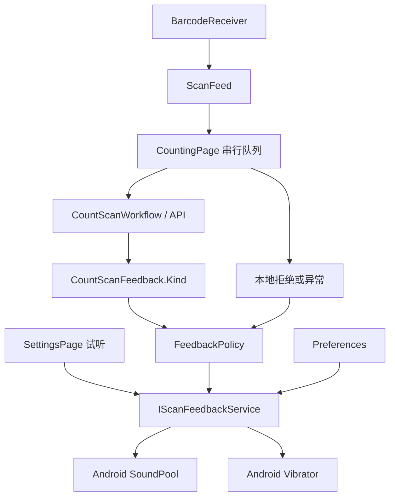

# PDA 扫码业务声音与震动反馈改造方案

> [!IMPORTANT]
> 本节保留原规划及触发矩阵（需求 ID PDA-FB-01～08）；2026-11-26 已在 feature/pda-scan-feedback 分支编码 PDA-FB-02～06，构建和真机验收未确认，详见末尾实施记录。基于 StockCount 源码基线 `ab53a15b2101a856393a0626267c314dfa9ccacc` 及 2026-11-26 原版 X3 PDA v1.8.9 静态研究。原版音频授权未确认，不提交到公开项目；本仓库附带独立数学合成 WAV，不含原 APK 音频、采样或波形。具体音色及真机播放效果待用户验收。

## 1. 反馈规范

| 类型 | 音频资源（候选） | 长度 | 振动 | 默认 |
| --- | --- | ---: | ---: | --- |
| Success | scan_success.wav | 626 ms | 200 ms | 开 |
| Failure | scan_failure.wav | 840 ms | 1000 ms | 开 |
| Read | scan_read.wav | 125 ms | 无 | 关 |
| WarningUnknown | 复用 Failure | 840 ms | 1000 ms | 开 |
| Neutral | 无 | — | — | 不播放 |

参考旧版业务反馈时长，而非复制旧版音色。旧版 playAlarmSound 实际使用失败资源 f.ogg，不是 alarm.ogg；msg.mp3 和 alarm.ogg 未确认业务触发，不纳入 V1。WarningUnknown 只表示需操作员关注，绝不等于服务器已拒绝或未写入。

### 音频试听与资源

- 成功（上行双音）：[scan_success.wav](audio-feedback/scan_success.wav)
- 失败（下行低音）：[scan_failure.wav](audio-feedback/scan_failure.wav)
- 读码（短音）：[scan_read.wav](audio-feedback/scan_read.wav)

音频均为 PCM 16-bit / mono / 16 kHz WAV，便于 SoundPool 加载。样品暂放 docs/pda/audio-feedback，实施时迁移到 Android res/raw 对应路径，不同时在两个打包目录注册同一资源。资源生成说明见 [[docs/pda/audio-feedback/README|音效说明]] · [Markdown](audio-feedback/README.md)。

## 2. 当前代码与改造入口

| 文件（基线） | 已有职责 | 改造 |
| --- | --- | --- |
| [MainActivity.cs](../../src/StockCount.Pad/Platforms/Android/MainActivity.cs) | OnResume 注册、OnPause 注销广播 | 接入前后台反馈生命周期，不在 Receiver 判定业务成功 |
| [ScanFeed.cs](../../src/StockCount.Pad/Services/ScanFeed.cs) | 清理末尾 CR/LF，分发 ScanReceived/ScanObserved | 保持桥接；可选读码音仅在前台消费入口，避免双事件播放 |
| [CountScanWorkflow.cs](../../src/StockCount.Core/CountScanWorkflow.cs) | 返回 CountScanFeedback.Kind；原 UUID 幂等/持久化 | 保持纯 Core，无 Android API；可增加纯反馈分类类型/测试，不改变事务 |
| [CountingPage.xaml.cs](../../src/StockCount.Pad/CountingPage.xaml.cs) | 串行队列、ShowFeedbackAsync、数量/提交/查结果 | 主要触发点；补齐绕过 ShowFeedbackAsync 的本地错误 |
| [CountListPage.xaml.cs](../../src/StockCount.Pad/CountListPage.xaml.cs) | 手动 new CountingPage/SettingsPage，含恢复入口 | 将统一服务实例传入全部页面构造路径 |
| [SettingsPage.xaml](../../src/StockCount.Pad/SettingsPage.xaml) / [后台代码](../../src/StockCount.Pad/SettingsPage.xaml.cs) | 连接、帐套、扫码参数、性能 | 新增扫码反馈区域，独立持久化，不触发 API 配置变更 |
| [MauiProgram.cs](../../src/StockCount.Pad/MauiProgram.cs) | DI | Singleton 注册 IScanFeedbackService |
| [AndroidManifest.xml](../../src/StockCount.Pad/Platforms/Android/AndroidManifest.xml) | INTERNET | 增加 android.permission.VIBRATE（普通权限） |
| [StockCount.Pad.csproj](../../src/StockCount.Pad/StockCount.Pad.csproj) | net10.0-android，min API 26 | 资源打包，核对 AndroidResource 自动/显式包含，避免重复 |

## 3. 完整触发矩阵

### 3.1 扫码与草稿

| ID | 实际入口 / 条件 | 音效 | 振动 | 业务约束 |
| --- | --- | --- | ---: | --- |
| F01 | OnScannerReceived 收到有效广播并接受进入队列 | Read（可选） | 0 | 硬件已响默认关闭；不代表校验成功 |
| F02 | ShowFeedbackAsync: LocationUpdated | Success | 200 | 库位已校验并更新 |
| F03 | ShowFeedbackAsync: BoxResolved | Success | 200 | 箱详情已解析；尚未落库 |
| F04 | ShowFeedbackAsync: Error（格式/无库位/库位不存在/箱标签不存在/已启用范围校验等） | Failure | 1000 | 以 Core/API 结果为准，不新增业务门禁 |
| F05 | ShowFeedbackAsync: Duplicate | Failure | 1000 | 重复箱被拒绝；不得误归类成功 |
| F06 | ProcessScanAsync: HandleScanAsync 异常 | Failure | 1000 | 保留现有异常/状态提示 |
| F07 | OnScannerReceived: 队列满（当前上限5） | Failure | 1000 | 限频；提示重扫最后一箱，不隐式处理 |
| F08 | OnScannerReceived: 正在提交/收尾拒收；ProcessScanAsync: busy | Neutral | 0 | 保留现有提示，忙时不反复蜂鸣；必要时区分可见拒收 |
| F09 | ProcessScanAsync: 同一未提交箱重扫 | Neutral | 0 | 提示直接提交，不清数量、不报已落库 |
| F10 | 草稿覆盖确认取消 / DraftNeedsConfirmation | Neutral | 0 | 用户取消不是错误；保留草稿 |
| F11 | HasUnresolvedSubmission 或无法丢弃待确认草稿 | WarningUnknown | 1000 | 限频、保留原 UUID 与数量 |
| F12 | 页面不可见、空扫码、设置页接收诊断 | Neutral | 0 | 设置页可主动试听，不冒充业务成功 |

### 3.2 数量、提交与恢复

| ID | 实际入口 / 条件 | 音效 | 振动 | 业务约束 |
| --- | --- | --- | ---: | --- |
| F13 | Submit_Clicked: TryGetQuantity 失败/EnterManualQuantity 抛异常 | Failure | 1000 | 每次明确提交操作最多一次；不对输入每键播放 |
| F14 | SubmitAsync: Error（缺字段、数量无效、草稿存储失败或 ScanCommitRejectedException） | Failure | 1000 | 不改变原有拒绝/草稿语义 |
| F15 | SubmitAsync / CheckPendingAsync: Unknown | WarningUnknown | 1000 | UI 明示待确认，原 UUID 和输入保留；不可标记提交失败已回滚 |
| F16 | SubmitAsync: Submitted | Success | 200 | 服务器确认；完成现有 AcknowledgeSuccessAsync 后发出，不等待音效/Toast |
| F17 | CheckPendingAsync / Retry: Submitted | Success | 200 | 与 F16 使用同 UUID 去重；同一提交只响一次（当前进程） |
| F18 | Submitted 但 AcknowledgeSuccessAsync 失败 | WarningUnknown | 1000 | 不播放普通成功音；明确服务器已确认保存、本机收尾异常，禁止重复提交 |
| F19 | CheckPendingAsync: Ready / Busy | Neutral | 0 | 无新业务结果 |
| F20 | SubmitCurrentAsync / Check_Clicked 未处理异常 | WarningUnknown | 1000 | 捕获时保留待确认草稿；不推断 DB 状态 |
| F21 | 恢复草稿、返回/取消确认、列表加载、连接测试 | Neutral | 0 | 不播放扫码业务音；恢复后只对新确认结果反馈 |
| F22 | 设置页主动试听 | 指定音 | 见设置 | 不发 API、不改盘点，不计业务事件 |

F16/F17/F18 在 ShowFeedbackAsync 的 Submitted 分支单独处理；先捕获当前 PendingRequestId，因为 AcknowledgeSuccessAsync 可能清空。对同一 UUID 成功反馈在进程生命周期内去重；重启后若仍为待确认且确认成功，可提示一次，不新增持久业务状态。警告去重独立于成功去重，后续真正确认成功仍可播放。现有 可配置成功 Toast（默认2000ms） 不因 626ms 音频延长。

## 4. 组件架构与接口



拟新增：

- Services/IScanFeedbackService.cs：统一 Notify(FeedbackEvent) 与 Preview(FeedbackKind)，非阻塞，不向业务调用者传播音频异常。
- Services/ScanFeedbackOptions.cs：声音总开关、震动总开关、成功/失败开关、可选读码音；Preferences 独立保存。
- Platforms/Android/AndroidScanFeedbackService.cs：SoundPool、Vibrator、加载状态、前后台生命周期。
- 可测试的 FeedbackPolicy（Core 中纯枚举/映射或独立纯 .NET 文件）：将 Kind 与本地拒绝原因映射为 FeedbackKind；Unknown 与 Error 不混淆。
- Platforms/Android/Resources/raw/scan_success.wav、scan_failure.wav、scan_read.wav：实施时复制经确认的本项目候选音频。

拟议接口（仅设计，不是现有源码）：

```csharp
public enum FeedbackKind { None, Read, Success, Failure, WarningUnknown }
public sealed record FeedbackEvent(FeedbackKind Kind, string Reason, Guid? RequestId = null);
public interface IScanFeedbackService
{
    void Notify(FeedbackEvent feedback);
    void Preview(FeedbackKind kind);
}
```

平台实现采用 SoundPool.Builder().SetMaxStreams(1)、AudioAttributes UsageAssistanceSonification / ContentTypeSonification；load 异步，OnLoadComplete 验证 status==0 后才允许播放。预加载后使用实际返回的 sample ID，不用列表索引作为 SoundPool soundId。Play volume 遵从系统音量（不强制最大），loop=0，rate=1.0。新业务音可停止旧 stream，Failure/Warning 优先于短 Read，避免后到读码声覆盖警告；相同高频警告建议 750ms 限频，普通成功不得全局限频导致丢失真实箱反馈。所有状态串行化，前台实例复用，后台停止音效和震动，销毁时 Release/Dispose；异步加载晚到须用生命周期代次拒绝。

Android min API 26，可使用 VibrationEffect.CreateOneShot(ms, DefaultAmplitude)；API 31+ 使用 VibratorManager.DefaultVibrator，旧版使用 Vibrator。检查 HasVibrator，捕获异常，不申请不必要权限或强行绕过勿扰模式。声音加载失败仍可震动，震动失败仍可发声，两者都失败只记非敏感诊断，不影响业务或 UI。

## 5. 设置页（拟议）

| 设置 | 默认 | Preference key 后缀（前缀 StockCount.Feedback.） |
| --- | --- | --- |
| 启用声音 | true | SoundEnabled |
| 启用震动 | true | VibrationEnabled |
| 业务成功反馈 | true | SuccessEnabled |
| 业务失败/待确认反馈 | true | FailureEnabled |
| 额外扫码读取音 | false | ReadEnabled |

成功/失败分类开关同时控制该分类的声音和震动；总开关独立控制各通道。读码音无震动。两个试听按钮（成功/失败）遵守当前开关并显示禁用提示；不得走真实 API。设置即时保存，与 API 地址、密钥、帐套保存及待确认草稿门禁独立。初始加载 UI 不能触发试听或保存回调循环。

## 6. 实施顺序与验收

| 任务 ID | 工作 | 验收 |
| --- | --- | --- |
| PDA-FB-01 | 确认音色与触发矩阵 | 本文与 3 个 WAV 样品可试听 |
| PDA-FB-02 | 纯策略与 Fake 服务 | F01–F22 参数化测试，Unknown 与 Duplicate 独立 |
| PDA-FB-03 | Android 播放/振动与 Manifest | 音频加载失败、无振动器、后台/恢复、释放均不崩溃 |
| PDA-FB-04 | DI 与所有页面构造入口 | 同一实例、手动 new 两条 CountingPage 路径与 SettingsPage 无遗漏 |
| PDA-FB-05 | 扫码/提交/恢复接线 | 一次业务结果最多一次反馈，原 UUID/草稿/队列保持 |
| PDA-FB-06 | 设置页持久化及试听 | 开关组合、重启保存、无 API 调用 |
| PDA-FB-07 | 构建测试及打包 | Android Debug/Release APK 含 3 raw 资源，Core 原测试通过 |
| PDA-FB-08 | 海康 PDA 真机验收 | 实际成功/失败音、震动时长、快速扫码、超时/恢复、系统静音行为 |

验收重点：普通成功不阻塞主线程、队列或 可配置 Toast（默认2000ms）；音频播放耗时不计入业务网络时延；同 UUID 重试确认只播放一次；业务未知始终保留草稿；F18 不误导重复提交；快速扫码时不出现持续警报风暴。硬件成功音与业务成功音区分，不能通过关闭硬件读码反馈来假装业务反馈已实现。

原规划不涉及数据库、API 契约或实际盘点权限修改。实际实施见下节。

## 知识库导航

- [[docs/pda/00-PDA扫码知识地图|PDA 扫码地图]] · [Markdown](00-PDA%E6%89%AB%E7%A0%81%E7%9F%A5%E8%AF%86%E5%9C%B0%E5%9B%BE.md)
- [[docs/pda/PDA-UI-开发任务与验收|PDA UI 任务]] · [Markdown](PDA-UI-开发任务与验收.md)
- [[docs/pda/PDA-UI-UX-设计规范与交互状态|PDA UI 设计]] · [Markdown](PDA-UI-UX-设计规范与交互状态.md)
- [[docs/SCANNER_INTEGRATION|扫码集成]] · [Markdown](../SCANNER_INTEGRATION.md)
- [[docs/00-文档导航|文档总目录]] · [Markdown](../00-%E6%96%87%E6%A1%A3%E5%AF%BC%E8%88%AA.md)


## 7. 2026-11-26 实施记录（代码待 CI/真机验收）

- Core：FeedbackPolicy、FeedbackGate、ScanFeedbackOptions 及 42 项参数化/独立测试用例；反馈只分类，不决定业务结果。F08/F09/F10/F12/F19/F21 保持原 UI 或静默；F22 直接 Preview，避免进入业务去重。F01～F22 其余非静默触发均接入 CountingPage。
- Android：单实例 SoundPool + Vibrator，前台预加载、后台释放、代次过滤迟到加载回调；声音加载不就绪不重放旧事件，保留震动。使用三份独立合成 WAV，添加 VIBRATE 权限。
- UI：三条构造入口共享同一服务，设置五开关及两个试听按钮独立保存；Submitted 先保留原 UUID、完成既有清理、再反馈；Unknown 不清除 UUID。
- CI：新增 APK ZIP 原始音频 SHA-256 检查，Debug、Release QA、正式签名产物均验证三资源。当前环境无 dotnet / Android workload，不能声称本地编译通过；以 PR workflow 为准。真机声音、系统音量、震动、连续扫码与恢复测试仍待 PDA-FB-08。
- 原版私有音频未进入公开仓库，生产写入权限、数据库、API、端口均未修改。


## 2026-11-26 PDA 键盘与成功提示

- [[docs/pda/PDA 键盘避让与提交成功提示配置|键盘避让与提交成功提示配置]] · [Markdown](PDA%20%E9%94%AE%E7%9B%98%E9%81%BF%E8%AE%A9%E4%B8%8E%E6%8F%90%E4%BA%A4%E6%88%90%E5%8A%9F%E6%8F%90%E7%A4%BA%E9%85%8D%E7%BD%AE.md) — IME Resize、固定操作栏、默认2秒及可配置时长；源码待 CI/真机验收。


## PDA-FB-09～16：统一业务提示与失败音效可靠性（2026-11-26）

现场反馈扫错库位/箱码时只有震动。源码原本已将 Error/Duplicate 分类为 Failure；SoundPool 未就绪、Play 返回0等情况原先静默跳过，尚无真机日志证明根因。本次改用媒体音量流（SoundPool AudioUsageKind.Media，MediaPlayer 默认媒体流），Activity 音量键对应 Music，不强制音量。Sample ID/status、播放返回 stream、媒体音量及备用播放启动/失败通过 StockCountFeedback 标签诊断；成功启动不证明扬声器实际发声。业务成功/失败/未知在 SoundPool 无资源、未加载、异常或0 stream 时走同 WAV 的 MediaPlayer 备用；额外短读码音不备用。备用创建有原生准备开销但不等待播放完成；每次新业务反馈停止释放旧播放器，暂停/销毁/关闭声音同样释放；不重播过时事件，振动独立。

| 触发 | 新 UI | 声音/震动 |
| --- | --- | --- |
| F04/F05：库位错、未扫库位、箱码错误、不存在、已盘 | 红色非阻塞 Toast | Failure / 1000ms |
| F06 扫码读取异常 | 红色 Toast（未发生写入） | Failure / 1000ms |
| F07 队列满 | 红色 Toast，重扫提示 | 限频 Failure / 1000ms |
| F13 数量错误 | 红色 Toast；保留输入；未知状态仍确认 | Failure / 1000ms |
| F14 提交时明确 BOX_ALREADY_RECORDED | 红色 Toast，按既有规则清箱和数量 | Failure / 1000ms |
| F14 其他提交拒绝（结构、存储、授权等） | 保留人工确认 | Failure / 1000ms |
| F16/F17 确认提交成功 | 绿色非阻塞 Toast | Success / 200ms |
| F02/F03 正确库位/箱码 | 清除旧失败 Toast，保留原状态文字 | Success / 200ms |
| F10/F11/F15/F18/F20、草稿恢复 | 人工确认/原 UUID 保持 | 原规则 |

统一“业务提示显示时长”，保留旧 Preferences key StockCount.Interaction.SuccessToastDurationMs（默认2000，0.5/1/2/3/5秒），无迁移、无新增等待；SuccessToastLifetime 版本机制共用，新提示覆盖旧提示，离页或有效扫码清除失败提示；触摸穿透、自动换行。Core CountScanFeedback 增加可选 ErrorCode 以区分服务端明确重复，不根据中文消息猜测。未更改写入、库位、幂等、扫码队列、历史 API。新增25项纯策略测试。验收需用海康真机开启声音、失败反馈，试听成功/失败，检查媒体音量，扫码错库位/无库位/无标签/重复，快速纠错，退出重入，断网未知仍阻止覆盖；用 `adb logcat -s StockCountFeedback` 查看加载/播放/备用路径，严禁上传业务敏感数据。源码已提交，CI/真机待核验。


## 原版成功/失败音效替换（2026-11-26）

StockCount main 构建改用原始 s.ogg / f.ogg（不转码），Android 资源 ID scan_success / scan_failure 不变。合成 scan_read.wav 保留，反馈分类、音量、播放备用、震动、Toast、API 与数据库逻辑不变。实际 APK 使用固定 SHA-256 验证两段 OGG，并确保无旧成功/失败 WAV。详见 [音效样品及资源版本](audio-feedback/README.md)。
